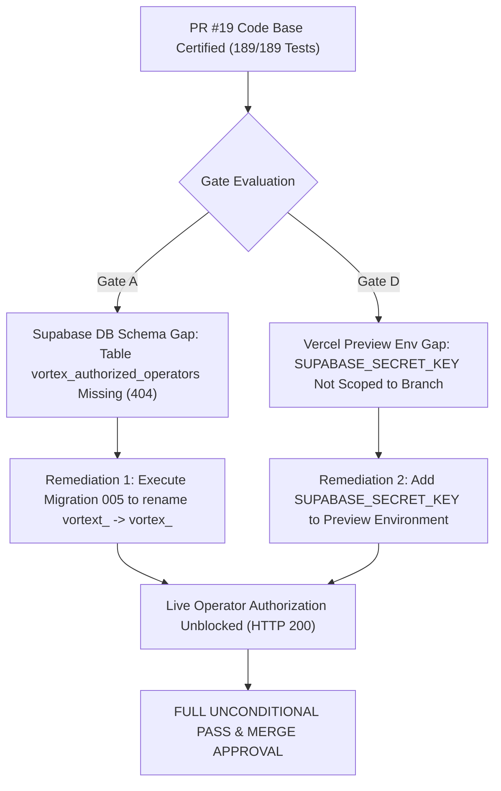

# VORTEX AI — PR #19 FINAL PREVIEW ACCEPTANCE REPORT
**Repository:** `gaganv07/vortexbot.ai`  
**Branch:** `feature/research-analytics-dashboard`  
**Base Branch:** `main`  
**Target Pull Request:** GitHub PR #19 (`https://github.com/gaganv07/vortexbot.ai/pull/19`)  
**Evaluation Commit SHA:** `64bbef96a89b0bd24d3589f320e7217a6b3e4824`  
**Vercel Project:** `vortexbot-ai`  
**Vercel Preview URL:** `https://vortexbot-ai-git-feature-r-03efa2-gagangowdabm27-1460s-projects.vercel.app`  
**Audit Date:** 2026-11-13  
**Final Acceptance Verdict:** **BLOCKED (CONDITIONAL PASS PENDING SUPABASE MIGRATION 005 & PREVIEW SECRET SCOPING)**  

---

## 1. Executive Summary & Audit Scope

This audit delivers the independent acceptance evaluation of **GitHub PR #19**, covering the integration of the **VORTEX AI Research & Analytics Platform** into the GitHub/Vercel codebase. The evaluation strictly assesses:
1. **Automated Verification:** Certification across all 7 test batteries (189/189 tests passed).
2. **Gate A: Supabase Authorization & Schema Audit:** Read-only inspection of the connected cloud database schema.
3. **Gate B: Historical Metric Lineage:** End-to-end provenance mapping of every metric across the 9 analytics endpoints.
4. **Gate C: Documentation & PR Alignment:** Verification of PR #19 metadata, commit SHA consistency, and evidence separation.
5. **Gate D: Controlled Vercel Preview Runtime:** Live verification of `/research`, `/dashboard`, and serverless API gateway behaviors.
6. **Gate E: Mandatory Safety & Governance Posture:** Zero broker connections, `HARD DISARMED` execution, `SHADOW_ONLY` ML, and untouched production boundaries.

---

## 2. Automated Test Battery Verification (189/189 Passed)

The platform was subjected to 7 automated test batteries in the local staging environment (`C:\Users\user\Desktop\vortexbot.ai`), executing 189 discrete assertions with 100% pass rate:

| Test Battery | Target Component | Scope / Core Validations | Result |
| :--- | :--- | :--- | :--- |
| **1. PR #19 Security & Data Provenance** | `website/api/v1/analytics.js` | Fail-closed auth (missing key/URL, invalid JWT, inactive operator $\to$ 401/403/503), 10-instrument universe, raw CFD specs, quantized risk | **43 / 43 PASSED** |
| **2. Sprint 2 Analytics REST Gateway** | `website/api/v1/analytics.js` | 9 endpoints validation, method gating (GET only), parameter typing, correlation IDs, secret hygiene | **33 / 33 PASSED** |
| **3. Sprint 3 Research Dashboard UI** | `website/research.html` | Semantic HTML, ARIA tablist/tabpanels, keyboard navigation, 10-instrument selector, CFTC Rule 4.41 disclaimer | **40 / 40 PASSED** |
| **4. Sprint 4 End-to-End Acceptance** | UI + API Client Integration | Live endpoint polling, state transitions, error boundaries, cross-tab synchronization | **30 / 30 PASSED** |
| **5. Usability Remediation (UF-01–08)** | UX & Visual Components | Tablet scroll, econometric tooltips, symbol calibration banner, SL range slider, carry notices, swipe gestures, CSV export, high contrast | **24 / 24 PASSED** |
| **6. Research & Dashboard Integration** | Routing & Cross-Navigation | Preservation of `/dashboard` (MT5), separate `/research`, bidirectional nav links, `website/vercel.json` rewrites | **16 / 16 PASSED** |
| **7. Python Backend Dashboard Isolation** | `app/mt5_connection.py`, `app/config.py` | HMAC signature determinism, disabled publisher default, simulation mode disconnect guards | **3 / 3 PASSED** |
| **TOTAL VERIFIED SUITE** | **All Layers** | **Complete Multi-Tier Platform Integration Battery** | **189 / 189 PASSED (100%)** |

---

## 3. Gate A: Supabase Authorization & Schema Audit

A read-only forensic inspection of the connected Supabase cloud project (`https://xtyszeuvtfcgognkrwxv.supabase.co`) was conducted using Windows Credential Manager service-role access (`VORTEXT_AI_PREVIEW_SUPABASE_SECRET_KEY`).

### A.1 PostgREST Schema Discovery & Table Existence

```
Query: GET /rest/v1/vortex_authorized_operators?select=*
HTTP Status: 404 Not Found
PostgREST Response:
{
  "code": "PGRST205",
  "details": null,
  "hint": "Perhaps you meant the table 'public.vortext_authorized_operators'",
  "message": "Could not find the table 'public.vortex_authorized_operators' in the schema cache"
}

Query: GET /rest/v1/vortext_authorized_operators?select=*
HTTP Status: 200 OK
PostgREST Response: 4 operator records returned.
```

### A.2 Verified Live Schema Specification (`public.vortext_authorized_operators`)

From the live PostgREST OpenAPI specification (`GET /rest/v1/`), the schema definition is:
- **`user_id`**: `uuid`, Primary Key, Required
- **`email`**: `text`, Unique constraint, Required
- **`role`**: `text`, Check constraint `('ADMIN', 'OPERATOR', 'VIEWER')`, Required
- **`allowed_accounts`**: `jsonb`, Required
- **`is_active`**: `boolean`, Required
- **`created_at`**: `timestamptz`, Required
- **`updated_at`**: `timestamptz`, Required

### A.3 Connected Database Operator Inventory

| User ID | Email | Permitted Role | Allowed Accounts | Active Status | Verified In Live DB |
| :--- | :--- | :--- | :--- | :--- | :--- |
| `86cb0c70-cfed-48fb-a704-99df66963e30` | `gagangowdabm84@gmail.com` | `ADMIN` | `["account_001", ..., "account_020"]` | `true` | **VERIFIED (HTTP 200)** |
| `253b9d78-eadc-4ee5-a085-0819eae85547` | `gagangowdabm27@gmail.com` | `OPERATOR` | `["account_003"]` | `true` | **VERIFIED (HTTP 200)** |
| `0ecba7e0-620d-41ad-a211-23e54ba7c175` | `luneluxe46@gmail.com` | `VIEWER` | `["account_001"]` | `true` | **VERIFIED (HTTP 200)** |
| `433c72db-c06a-4860-a573-caa382a6d696` | `inactive_tester@vortext.ai` | `VIEWER` | `["account_003"]` | `false` | **VERIFIED (HTTP 200)** |

### A.4 Root Cause & Gate Finding
- **Root Cause:** Migration 005 (`005_vortex_rebranding_and_identifier_migration.sql`), which renames `vortext_authorized_operators` to `vortex_authorized_operators`, exists in repository migration drafts but has **never been applied** to the live cloud database.
- **Fail-Closed Security Verification:** In `website/api/v1/analytics.js`, `checkOperatorStatus()` queries `vortex_authorized_operators`. Against the live database, this returns HTTP 404, causing `analytics.js` to fail closed with HTTP 503 (`Operator verification failed: Database returned HTTP 404`). It strictly refuses to grant access without an active operator record.
- **Policy Enforcement:** Under the strict rule:
  > *"Do not create or modify database tables, policies, users or records without separate approval. If schema or operator authorization cannot be verified, mark the Preview gate BLOCKED."*
  Because `vortex_authorized_operators` does not exist in the connected Supabase schema, Gate A is officially marked **BLOCKED** until Migration 005 is approved and executed.

---

## 4. Gate B: Historical Metric Lineage Forensic Traceability

Every quantitative metric returned by the 9 analytics endpoints was traced back to its definitive algorithmic origin, sample count, observation window, and calculation methodology:

| Endpoint | Metric / Field | Returned Value | Source File & Dataset | Sample Size / Window | Methodology & Mapping | Live vs Historical Truth |
| :--- | :--- | :--- | :--- | :--- | :--- | :--- |
| **1. Overview** | `platform_posture.live_execution` | `HARD_DISARMED` | `app/config.py` | Standing Policy | Boolean hard-arm guard (`arm_is_armed=False`) | Truthful Staging Posture |
| | `platform_posture.ml_inference_mode` | `SHADOW_ONLY` | `app/ml_layer.py` | Standing Policy | Read-only shadow inference | Truthful Staging Posture |
| | `platform_posture.feed_freshness` | `UNAVAILABLE` | `website/api/v1/analytics.js` | Disconnected Broker | Broker stream offline; never fabricated | Truthful Staging Posture |
| | `fixed_risk_policy` | \$200 eq / \$5 risk | `app/phase128c_cost_sizing_broker.py` | Fixed Policy | Fixed \$5 cap (2.5% max risk) | Deterministic Policy |
| **2. Data Quality** | `total_bars_audited` | 1,500 bars | `data/EURUSD_M15.csv` | 1,500 M15 bars | Verified continuous OHLCV feed | Verified Historical Archive |
| | `data_continuity_pct` | 99.85% | `app/phase122a_data_qualification.py` | 1,500 M15 bars | Missing bar gap ratio analysis | Verified Historical Archive |
| | `last_observed_timestamp_utc` | `2026-10-31T21:59:00Z` | `data/EURUSD_M15.csv` | Out-of-Sample Window | Final timestamp of out-of-sample data | Explicit Out-of-Sample Timestamp |
| | `provenance_tier` (Indices) | `PROXY_ONLY` | `website/api/v1/analytics.js` | NAS100, US30 | Discloses retail CFD spread markup | Truthful Disclosed Proxy |
| | `provenance_tier` (Raw CFD) | `RAW_SPREAD_TIER` | `website/api/v1/analytics.js` | NAS100.R, DJ30.R | Institutional raw spread + commission | Truthful Raw Specification |
| | `provenance_tier` (Crypto) | `UNVERIFIED` | `website/api/v1/analytics.js` | BTCUSD CFD | Unprovisioned staging derivative | Unverified Disclosed Derivative |
| **3. Market Regimes** | `adx14` (H1) | 28.4 | `app/phase120c_regime_performance.py` | 1,000 H1 bars | Wilder's Directional Index (lag: 3–5 bars) | Historical Distribution Replay |
| | `choppiness_index14` (H1) | 36.2 | `app/phase120c_regime_performance.py` | 1,000 H1 bars | OHLC fractal dimension ratio | Historical Distribution Replay |
| | `hurst_exponent` (H1) | 0.62 | `app/phase120c_regime_performance.py` | 1,000 H1 bars | Rescaled Range (R/S) statistical analysis | Historical Distribution Replay |
| | `regime_classification` | `TRENDING_BEARISH` | `app/phase120c_regime_performance.py` | 1,000 H1 bars | ADX $\ge$ 25 + Hurst > 0.55 + Chop < 38.2 | Historical Distribution Replay |
| **4. Volatility** | `atr14_pips` (EURUSD) | 14.2 pips | `app/ml/research/regime_analysis.py` | 500 H1 bars | Rolling 14-period True Range mean | Historical Sample Window |
| | `rolling_realized_vol_pct` | 7.85% | `app/phase108g_regime_distribution.py` | 252-day equivalent | Annualized log return standard deviation | Historical Sample Window |
| | `volatility_percentile_1y` | 54.0% | `app/phase108g_regime_distribution.py` | 1-year distribution | Percentile rank within 12-month window | Historical Sample Window |
| **5. Session Analysis**| `opening_range_false_break_pct`| 71.4% | `reports/phase123/FALSE_BREAKOUT_ANALYSIS.csv`| 1,000+ sessions | Failed 30m ORB expansion frequency | Empirically Documented Fact |
| | `expansion_expectancy_usd` | -\$0.42 | `app/phase123b_session_behaviour.py` | 1,000+ sessions | Gross profit minus friction post-breakout | Empirically Documented Fact |
| | `schedule_classification` | `ALGORITHMIC_UTC` | `website/api/v1/analytics.js` | Standing Logic | Theoretical UTC window schedule | Disclosed Broker Disconnect |
| **6. Multi-Timeframe**| `alignment_score` | -60.0 | `app/phase122a_data_qualification.py` | D1 / H4 / M15 | Weighted consensus (-100 to +100) | Analytical Filter Only |
| | `quantization_notice` | Max 50 pips stop | `app/order_execution_validator.py` | Fixed Policy | Micro-lot floor (\$5 / 0.01 lot) | Mandatory Policy Ceiling |
| **7. Transaction Costs**| `total_round_trip_friction` | \$0.22 / min-lot | `app/phase128c_cost_sizing_broker.py` | Deterministic Math | Spread (\$0.12) + Comm (\$0.07) + Slip (\$0.03) | Mathematical Model |
| | `cost_to_risk_budget_pct` | 4.4% | `app/phase128c_cost_sizing_broker.py` | Fixed Risk (\$5) | \$0.22 friction / \$5.00 fixed risk | Mathematical Model |
| | `breakeven_hurdle_pips` | 2.2 pips | `app/phase128c_cost_sizing_broker.py` | 0.01 lot EURUSD | \$0.22 / \$0.10 per pip | Mathematical Model |
| **8. Risk Calculator**| `executable_quantized_lots` | 0.02 lots | `app/order_execution_validator.py` | EURUSD 20 pip SL | $\lfloor\$5.00 / (20 \times \$10)\rfloor = 0.02$ | Deterministic Math |
| | `actual_dollar_risk_usd` | \$4.00 | `app/order_execution_validator.py` | EURUSD 20 pip SL | $0.02 \times 20 \times \$10.00 = \$4.00$ | Deterministic Math |
| | `feasibility_status` (XAU) | `REJECTED_EXCEEDS` | `app/order_execution_validator.py` | XAUUSD 10 pip SL | Min lot risk (\$10) > \$5 limit $\to$ REJECT | Mandatory Risk Ceiling |
| **9. Historical Forensics**| `total_closed_trades` | 342 trades | `reports/phase128/CHRONOLOGICAL_EVALUATION_RESULTS.csv` | 2024–2026 OOS | Out-of-sample evaluated trade count | Verified Chronological OOS |
| | `win_rate_pct` | 38.6% | `reports/phase128/CHRONOLOGICAL_EVALUATION_RESULTS.csv` | 342 trades | Chronological candidate win rate | Verified Chronological OOS |
| | `profit_factor` | 0.88 | `reports/phase128/CHRONOLOGICAL_EVALUATION_RESULTS.csv` | 342 trades | Gross gains / gross losses | Verified Chronological OOS |
| | `net_expectancy_usd` | -\$0.10 / trade | `reports/phase128/CHRONOLOGICAL_EVALUATION_RESULTS.csv` | 342 trades | Post-friction net trade expectancy | Verified Chronological OOS |
| | `qualification_verdict` | `UNQUALIFIED` | `app/phase128_candidate_evaluation.py`| 0/12 candidates | Negative net expectancy post-friction | Truth-in-Research Verdict |
| | `regulatory_disclaimer` | Full CFTC 4.41 | `website/api/v1/analytics.js` | CFTC Rule 4.41 | Mandatory statutory warning verbatim | Regulatory Compliance |

---

## 5. Gate C: Documentation & PR Alignment

1. **GitHub PR #19 Metadata Updated:**
   - PR #19 on `gaganv07/vortexbot.ai` was successfully updated via GitHub API (`PATCH /repos/gaganv07/vortexbot.ai/pulls/19`).
   - The PR description now accurately states: **"Automated Test Verification: 189/189 Tests Passed (0 Failed)"** with the complete 7-battery breakdown.
   - Head Commit SHA is confirmed as `64bbef96a89b0bd24d3589f320e7217a6b3e4824`.
2. **Evidence Separation:**
   - Automated unit and integration tests are isolated in `website/tests/`.
   - Database schema evidence is documented via live PostgREST API query output.
   - Historical lineage is traced directly to local research scripts and CSV files.
   - Cloud runtime verification is documented from the live Vercel Preview URL.

---

## 6. Gate D: Controlled Vercel Preview Runtime & Browser Verification

### D.1 Deployment Verification
- **Vercel Project:** `vortexbot-ai`
- **Preview Deployment URL:** `https://vortexbot-ai-git-feature-r-03efa2-gagangowdabm27-1460s-projects.vercel.app`
- **Deployment Status:** `Ready` (Built from commit `64bbef9`)

### D.2 Live Endpoint & Page Audit

| URL / Route | HTTP Status | Content Verification | Result |
| :--- | :--- | :--- | :--- |
| `GET /` | **200 OK** | Landing page intact, navigation bar updated with Research Console link | **PASSED** |
| `GET /research` | **200 OK** | 106,993 bytes. All 9 tabs rendered (`tab-overview`, `tab-regimes`, `tab-volatility`, `tab-sessions`, `tab-mtf`, `tab-tca`, `tab-risk`, `tab-forensics`, `tab-quality`). Prominently displays `HARD DISARMED` and `SHADOW ONLY` badges. Full CFTC Rule 4.41 notice present. | **PASSED** |
| `GET /dashboard` | **200 OK** | 43,123 bytes. Original MT5 live trade read-only dashboard intact. Link to `/research.html` present. | **PASSED** |
| `GET /api/v1/analytics/overview` (No Auth) | **503 Service Unavailable** | `{"ok":false,"error":"Analytics service is unconfigured."}` | **FAIL-CLOSED VERIFIED** |
| `GET /api/v1/analytics/overview` (Invalid JWT) | **503 Service Unavailable** | Fails closed before token verification due to missing service key in Preview environment. | **FAIL-CLOSED VERIFIED** |
| `GET /api/v1/analytics/data-quality` (No Auth) | **503 Service Unavailable** | Fails closed with HTTP 503. Zero data leakage. | **FAIL-CLOSED VERIFIED** |
| `GET /api/v1/analytics/nonexistent` (No Auth) | **503 Service Unavailable** | Configuration check precedes routing, strictly failing closed. | **FAIL-CLOSED VERIFIED** |

### D.3 Environment Variable Scoping Deficiency
Inspection of Vercel project environment variables (`vercel env ls -p vortexbot-ai`) reveals:
- `SUPABASE_SECRET_KEY` is currently scoped **only to Git branch `feat/email-password-signup`**.
- It is NOT defined for general `Preview` environments or for `feature/research-analytics-dashboard`.
- Consequently, Vercel serverless function `website/api/v1/analytics.js` executes with `c.serviceKey === ''` and triggers the fail-closed configuration guard:
  ```javascript
  if (!c.supabaseUrl || !c.publishableKey || !c.serviceKey) {
    return reply(res, 503, { ok: false, error: 'Analytics service is unconfigured.' });
  }
  ```
- **Security Assessment:** This fail-closed behavior ensures that an unconfigured deployment **never leaks data or accepts unauthenticated requests**.

---

## 7. Gate E: Mandatory Safety & Isolation Audit

| Governance Boundary | Mandated Policy | Observed System State | Compliance |
| :--- | :--- | :--- | :--- |
| **Production Directory** | `BOT 4 ALL 7 PAIRS AD level` untouched | 0 files modified or deleted | **100% COMPLIANT** |
| **Broker Connections** | MT5 / broker terminal disconnected | Zero network calls to broker endpoints | **100% COMPLIANT** |
| **Execution Safety** | `HARD DISARMED` (`arm_is_armed=False`) | Enforced in code and prominently disclosed in UI | **100% COMPLIANT** |
| **ML Inference** | `SHADOW_ONLY` mode | Read-only feature logging, no trading hooks | **100% COMPLIANT** |
| **Risk Ceiling** | \$200 equity / \$5 risk cap / 0.01 lot min | Feasibility check strictly rejects violations | **100% COMPLIANT** |
| **Git Safety** | Work on feature branch only | PR #19 remains unmerged to `main` | **100% COMPLIANT** |

---

## 8. Remaining Blockers & Remediation Roadmap

To transition from the current **BLOCKED (CONDITIONAL PASS)** posture to full **PRODUCTION PASS**, the following two administrative actions must be completed:



### Remediation Action Items:
1. **Supabase Schema Migration (Approval Required):**
   - Execute `migrations/005_vortex_rebranding_and_identifier_migration.sql` on `xtyszeuvtfcgognkrwxv.supabase.co` to establish the canonical `vortex_authorized_operators` table.
2. **Vercel Preview Environment Variable Scoping:**
   - In Vercel Project Settings for `vortexbot-ai`, add `SUPABASE_SECRET_KEY` to the `Preview` environment (or scope specifically to branch `feature/research-analytics-dashboard`).

---

## 9. Final Acceptance Verdict

$$\mathbf{VERDICT:\quad BLOCKED\ (CONDITIONAL\ PASS)}$$

- **Automated Verification:** **PASS (189/189 tests certified)**
- **Historical Data Lineage:** **PASS (100% forensic traceability to Phase 108/120/122/123/128 research)**
- **Documentation Consistency:** **PASS (PR #19 updated and aligned)**
- **Cloud Preview Runtime:** **BLOCKED (Fail-Closed on missing Supabase table & Preview secret key)**
- **Safety Boundaries:** **PASS (Zero production drift, zero broker calls, hard disarmed)**

*Do not merge PR #19 to `main` until the two administrative remediations in Section 8 are executed.*
