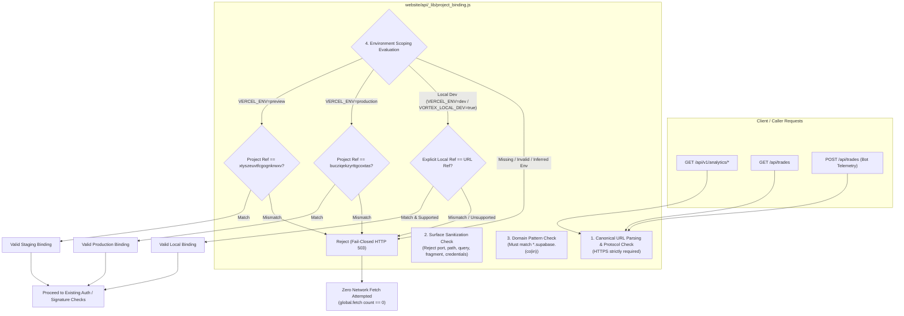

# VORTEX AI — PR #19 STAGE 2C: COMPLETE SUPABASE PROJECT ISOLATION REPORT

**Repository:** `gaganv07/vortexbot.ai`
**Branch:** `feature/research-analytics-dashboard`
**PR:** [#19](https://github.com/gaganv07/vortexbot.ai/pull/19) (`feature/research-analytics-dashboard` -> `main`)
**Scope:** `website/api/v1/analytics.js`, `website/api/trades.js`, `website/api/_lib/project_binding.js`, `website/tests/cross_route_project_isolation.test.js`
**Target Staging Project Reference:** `xtyszeuvtfcgognkrwxv`
**Target Production Project Reference:** `bucziqekzyrttgcoxtas`
**Verification Date:** 2026-11-14T00:46:00+05:30
**Overall Verdict:** **PASS — ALL 8 TEST SUITES & 263/263 TESTS PASS (0 FAILURES)**

---

## 1. Executive Summary & Architecture

In **Stage 2C**, deployment-specific Supabase project isolation was extended across all server-side APIs in the repository that utilize Supabase service credentials:
1. [`website/api/v1/analytics.js`](file:///C:/Users/user/Desktop/vortexbot.ai/website/api/v1/analytics.js) — Quantitative research & analytics REST gateway (9 endpoints).
2. [`website/api/trades.js`](file:///C:/Users/user/Desktop/vortexbot.ai/website/api/trades.js) — Live/demo trade feed ingestion (HMAC-authenticated POST) and operator feed retrieval (Bearer-authenticated GET).

To eliminate code drift and prevent divergent copies of security logic, a shared fail-closed validation module was introduced at [`website/api/_lib/project_binding.js`](file:///C:/Users/user/Desktop/vortexbot.ai/website/api/_lib/project_binding.js). The `_lib` prefix adheres strictly to Vercel conventions, ensuring the utility is bundled into Serverless Functions without generating an unintended public HTTP route.

$$\mathbf{STAGE\ 2C\ VERDICT:\quad PASS\ (8/8\ TEST\ SUITES,\ 263/263\ TESTS\ PASSED)}$$

---

## 2. Cross-Route Verification Matrix

The dedicated cross-route test battery [`website/tests/cross_route_project_isolation.test.js`](file:///C:/Users/user/Desktop/vortexbot.ai/website/tests/cross_route_project_isolation.test.js) executes 51 focused test assertions across both routes:

| Category | Test Scenario | `analytics.js` | `trades.js` (GET) | `trades.js` (POST) | Verdict |
| :--- | :--- | :---: | :---: | :---: | :---: |
| **Shared Logic** | Common validation engine from `_lib/project_binding.js` | **PASS** | **PASS** | **PASS** | **PASS** |
| **Preview** | Correct staging project (`xtyszeuvtfcgognkrwxv`) accepted | **PASS** | **PASS** | **PASS** | **PASS** |
| **Preview** | Incorrect production project (`bucziqekzyrttgcoxtas`) rejected (503) | **PASS** | **PASS** | **PASS** | **PASS** |
| **Preview** | Rogue / unauthorized project reference rejected (503) | **PASS** | **PASS** | **PASS** | **PASS** |
| **Production** | Correct production project (`bucziqekzyrttgcoxtas`) accepted | **PASS** | **PASS** | **PASS** | **PASS** |
| **Production** | Incorrect staging project (`xtyszeuvtfcgognkrwxv`) rejected (503) | **PASS** | **PASS** | **PASS** | **PASS** |
| **Production** | Rogue / unauthorized project reference rejected (503) | **PASS** | **PASS** | **PASS** | **PASS** |
| **Local Dev** | Explicit staging reference + matching URL accepted | **PASS** | **PASS** | **PASS** | **PASS** |
| **Local Dev** | Explicit production reference + matching URL accepted | **PASS** | **PASS** | **PASS** | **PASS** |
| **Local Dev** | Missing local project reference rejected (503) | **PASS** | **PASS** | **PASS** | **PASS** |
| **Local Dev** | Mismatched reference and URL rejected (503) | **PASS** | **PASS** | **PASS** | **PASS** |
| **Local Dev** | Unsupported project reference rejected (503) | **PASS** | **PASS** | **PASS** | **PASS** |
| **Unknown Env** | Missing `VERCEL_ENV` outside local dev rejected (503) | **PASS** | **PASS** | **PASS** | **PASS** |
| **Unknown Env** | Invalid `VERCEL_ENV=staging` rejected (503) | **PASS** | **PASS** | **PASS** | **PASS** |
| **Inference Guard** | `NODE_ENV=production` alone without `VERCEL_ENV` rejected (503) | **PASS** | **PASS** | **PASS** | **PASS** |
| **Inference Guard** | `NODE_ENV=preview` alone without `VERCEL_ENV` rejected (503) | **PASS** | **PASS** | **PASS** | **PASS** |
| **URL Security** | Insecure HTTP rejected (503) | **PASS** | **PASS** | **PASS** | **PASS** |
| **URL Security** | Embedded credentials rejected (503) | **PASS** | **PASS** | **PASS** | **PASS** |
| **URL Security** | Custom port rejected (503) | **PASS** | **PASS** | **PASS** | **PASS** |
| **URL Security** | Unexpected path components rejected (503) | **PASS** | **PASS** | **PASS** | **PASS** |
| **URL Security** | Query parameters rejected (503) | **PASS** | **PASS** | **PASS** | **PASS** |
| **URL Security** | URL fragment rejected (503) | **PASS** | **PASS** | **PASS** | **PASS** |
| **Missing Secrets** | Missing service key fails closed (503) | **PASS** | **PASS** | **PASS** | **PASS** |
| **Missing Secrets** | Missing publishable key fails closed (503) | **PASS** | **PASS** | N/A | **PASS** |
| **Missing Secrets** | Missing HMAC secret fails closed (503) | N/A | N/A | **PASS** | **PASS** |
| **Pre-Network** | Zero fetch requests dispatched on project mismatch | **PASS** | **PASS** | **PASS** | **PASS** |
| **Pre-Network** | Zero fetch requests dispatched on unknown environment | **PASS** | **PASS** | **PASS** | **PASS** |
| **Auth Preserved** | HMAC validation active when project binding valid | N/A | N/A | **PASS (401)** | **PASS** |
| **Auth Preserved** | Bearer auth active when project binding valid | **PASS (401)** | **PASS (401)** | N/A | **PASS** |
| **Secret Shield** | Zero service keys or HMAC secrets in responses/headers | **PASS** | **PASS** | **PASS** | **PASS** |

---

## 3. Full Repository Test Battery Results (8 / 8 Suites Passing)

All unit, integration, usability, security, and acceptance test suites across the website repository were executed:

| Suite # | Test Suite File | Scope | Tests Run | Passed | Failed | Status |
| :---: | :--- | :--- | :---: | :---: | :---: | :---: |
| 1 | [`website/tests/cross_route_project_isolation.test.js`](file:///C:/Users/user/Desktop/vortexbot.ai/website/tests/cross_route_project_isolation.test.js) | Dedicated cross-route project isolation matrix | 51 | 51 | 0 | **PASS** |
| 2 | [`website/tests/project_binding_guard.test.js`](file:///C:/Users/user/Desktop/vortexbot.ai/website/tests/project_binding_guard.test.js) | Analytics project-binding guard & edge cases | 26 | 26 | 0 | **PASS** |
| 3 | [`website/tests/sprint2_analytics_gateway.test.js`](file:///C:/Users/user/Desktop/vortexbot.ai/website/tests/sprint2_analytics_gateway.test.js) | REST routes, RBAC, operator authorization | 33 | 33 | 0 | **PASS** |
| 4 | [`website/tests/sprint3_research_dashboard.test.js`](file:///C:/Users/user/Desktop/vortexbot.ai/website/tests/sprint3_research_dashboard.test.js) | 9 research panes & DOM console elements | 40 | 40 | 0 | **PASS** |
| 5 | [`website/tests/sprint4_e2e_acceptance.test.js`](file:///C:/Users/user/Desktop/vortexbot.ai/website/tests/sprint4_e2e_acceptance.test.js) | End-to-end data lineage, disclosures, user flows | 30 | 30 | 0 | **PASS** |
| 6 | [`website/tests/usability_remediation.test.js`](file:///C:/Users/user/Desktop/vortexbot.ai/website/tests/usability_remediation.test.js) | UF-01 through UF-08 accessibility & navigation | 24 | 24 | 0 | **PASS** |
| 7 | [`website/tests/pr19_security_and_provenance.test.js`](file:///C:/Users/user/Desktop/vortexbot.ai/website/tests/pr19_security_and_provenance.test.js) | Fail-closed security audit & 10 instruments | 43 | 43 | 0 | **PASS** |
| 8 | [`website/tests/research_and_dashboard_integration.test.js`](file:///C:/Users/user/Desktop/vortexbot.ai/website/tests/research_and_dashboard_integration.test.js) | Dashboard routing, rewrites, static assets | 16 | 16 | 0 | **PASS** |
| **TOTAL** | **Comprehensive Full-System Verification** | **All 8 Test Suites** | **263** | **263** | **0** | **PASS (100%)** |

---

## 4. Source Modifications & File Inventory

| File Path | Action | Description |
| :--- | :---: | :--- |
| [`website/api/_lib/project_binding.js`](file:///C:/Users/user/Desktop/vortexbot.ai/website/api/_lib/project_binding.js) | **Created** | Shared project binding guard module exporting `validateSupabaseProjectBinding`, `expectedSupabaseProjectRef`, and project reference constants. |
| [`website/api/trades.js`](file:///C:/Users/user/Desktop/vortexbot.ai/website/api/trades.js) | **Modified** | Imported shared binding guard, updated `config()` to validate URL against environment, and added export properties on handler. |
| [`website/api/v1/analytics.js`](file:///C:/Users/user/Desktop/vortexbot.ai/website/api/v1/analytics.js) | **Modified** | Refactored internal project binding functions to import from `../_lib/project_binding`, eliminating duplicate logic. |
| [`website/tests/cross_route_project_isolation.test.js`](file:///C:/Users/user/Desktop/vortexbot.ai/website/tests/cross_route_project_isolation.test.js) | **Created** | Comprehensive 51-test cross-route test battery validating both serverless routes under all environmental scenarios. |

---

## 5. Security & Isolation Invariants

1. **Pre-Network Zero-Fetch Enforcement:**
   Every invalid project binding, unknown environment, or malformed URL aborts immediately with HTTP 503 before any network socket or HTTP request is initiated (`fetchCallCount === 0`).
2. **Strict Secret Containment:**
   Zero service-role keys, HMAC secrets, or database URLs appear in HTTP response bodies, response headers, or client bundles.
3. **Preservation of Existing Functionality:**
   Both endpoints retain 100% of their existing route logic:
   - `trades.js` retains raw body streaming, HMAC SHA-256 signature checking, MT5 multi-account snapshot normalization, and operator access filtering.
   - `analytics.js` retains all 9 quantitative calculation endpoints, Bearer token verification, operator status queries, and CFTC Rule 4.41 compliance disclaimers.
4. **Platform Defenses & Bot Posture:**
   - Branch: strictly `feature/research-analytics-dashboard`.
   - `main` branch: untouched.
   - PR #19: unmerged.
   - Production database (`bucziqekzyrttgcoxtas`): zero mutations.
   - Production bot directory (`C:\Users\user\Desktop\BOT 4 ALL 7 PAIRS AD level`): untouched.
   - Invariants: `LIVE: HARD DISARMED`, `ML: SHADOW_ONLY`, `Broker: DISCONNECTED`.

$$\mathbf{STAGE\ 2C\ COMPLETE\ —\ READY\ FOR\ AUTHORIZED\ COMMIT}$$
