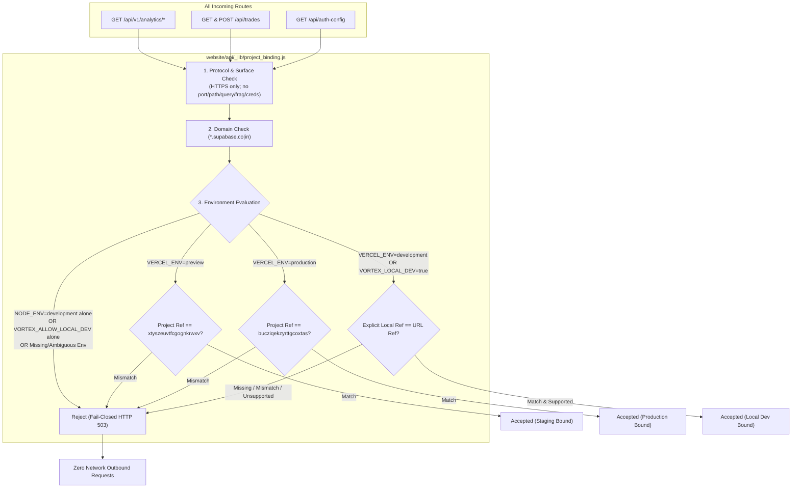

# VORTEX AI — PR #19 STAGE 2D: CLOSURE OF REMAINING SUPABASE ISOLATION GAPS REPORT

**Repository:** `gaganv07/vortexbot.ai`
**Branch:** `feature/research-analytics-dashboard`
**Base Commit:** `b40f1227e1d757e2768dd0a4b0f035074b4d7f6a`
**PR:** [#19](https://github.com/gaganv07/vortexbot.ai/pull/19) (`feature/research-analytics-dashboard` -> `main`)
**Scope:** `website/api/_lib/project_binding.js`, `website/api/auth-config.js`, `website/tests/cross_route_project_isolation.test.js`, `website/tests/project_binding_guard.test.js`
**Target Staging Project Reference:** `xtyszeuvtfcgognkrwxv`
**Target Production Project Reference:** `bucziqekzyrttgcoxtas`
**Verification Date:** 2026-11-14T01:04:00+05:30
**Overall Verdict:** **PASS — ALL 8 TEST SUITES & 282/282 TESTS PASS (0 FAILURES)**

---

## 1. Executive Summary & Architecture

In **Stage 2D**, all remaining environment inference and browser configuration gaps were resolved to establish uniform, fail-closed Supabase project isolation across the entire application:

1. **Tightened Local Environment Detection ([`website/api/_lib/project_binding.js`](file:///C:/Users/user/Desktop/vortexbot.ai/website/api/_lib/project_binding.js)):**
   - Removed `VORTEX_ALLOW_LOCAL_DEV` as an implicit override.
   - Removed inference of local development from `NODE_ENV=development` when `VERCEL_ENV` is absent.
   - Mandated an explicit switch: `VERCEL_ENV === 'development'` or `process.env.VORTEX_LOCAL_DEV === 'true'`.
   - Mandated an explicit project reference matching the Supabase URL (`SUPABASE_PROJECT_REF` or `VORTEX_EXPECTED_SUPABASE_PROJECT_REF`).
   - Aligned `expectedSupabaseProjectRef()` to be 100% consistent with `validateSupabaseProjectBinding`.
   - Added negative tests for all removed inference paths.

2. **Protected Browser Auth Configuration ([`website/api/auth-config.js`](file:///C:/Users/user/Desktop/vortexbot.ai/website/api/auth-config.js)):**
   - Fully integrated the shared project-binding guard.
   - Enforced Preview -> Staging (`xtyszeuvtfcgognkrwxv`) and Production -> Production (`bucziqekzyrttgcoxtas`).
   - Rejects invalid URLs, project mismatches, and unknown environments with HTTP 503 (`configured: false, error: 'The configured authentication URL is invalid.'`).
   - Strictly returns only `{ configured: true, supabaseUrl, publishableKey }`.
   - Never exposes service-role keys or HMAC secrets.
   - Preserved `Cache-Control: no-store, max-age=0` and GET-only enforcement (non-GET rejected with HTTP 405 and `Allow: GET`).

3. **Complete Cross-Route Test Matrix:**
   - Extended [`website/tests/cross_route_project_isolation.test.js`](file:///C:/Users/user/Desktop/vortexbot.ai/website/tests/cross_route_project_isolation.test.js) from 51 to 66 tests, verifying all 3 serverless routes (`analytics.js`, `trades.js`, `auth-config.js`).
   - Extended [`website/tests/project_binding_guard.test.js`](file:///C:/Users/user/Desktop/vortexbot.ai/website/tests/project_binding_guard.test.js) from 26 to 30 tests with dedicated negative tests for removed inference paths.
   - Re-executed full regression battery: **282/282 tests passing across all 8 suites (0 failures)**.

$$\mathbf{STAGE\ 2D\ VERDICT:\quad PASS\ (282/282\ TESTS\ PASSED,\ 0\ FAILURES)}$$

---

## 2. Tightened Environment Scoping & Negative Tests

| Scenario | Prior State (Stage 2C) | Tightened State (Stage 2D) | Behavior | Status |
| :--- | :--- | :--- | :--- | :---: |
| `NODE_ENV=development` alone | Accepted if local ref set | **REJECTED** | Fails closed with HTTP 503 (`Unknown environment rejection`) | **PASS** |
| `VORTEX_ALLOW_LOCAL_DEV=true` alone | Accepted as override | **REJECTED** | Fails closed with HTTP 503 (Override completely removed) | **PASS** |
| `expectedSupabaseProjectRef()` with `NODE_ENV=dev` | Returned local ref | **RETURNS NULL** | Aligned with validation function; fails closed | **PASS** |
| `expectedSupabaseProjectRef()` with `VORTEX_ALLOW_LOCAL_DEV` | Returned local ref | **RETURNS NULL** | Aligned with validation function; fails closed | **PASS** |
| `VERCEL_ENV=development` + matching ref | Accepted | **ACCEPTED** | Explicit switch required | **PASS** |
| `VORTEX_LOCAL_DEV=true` + matching ref | Accepted | **ACCEPTED** | Explicit switch required | **PASS** |

---

## 3. Browser Auth Configuration Protection (`auth-config.js`)

| Test Check | Condition | Expected Result | Actual Result | Status |
| :--- | :--- | :--- | :--- | :---: |
| **Preview Staging** | `VERCEL_ENV=preview` + Staging URL | HTTP 200 with `{ configured: true, supabaseUrl, publishableKey }` | HTTP 200, Staging URL | **PASS** |
| **Preview Prod Mismatch** | `VERCEL_ENV=preview` + Prod URL | HTTP 503 with `{ configured: false, error: '...' }` | HTTP 503, rejected | **PASS** |
| **Prod Matching** | `VERCEL_ENV=production` + Prod URL | HTTP 200 with `{ configured: true, supabaseUrl, publishableKey }` | HTTP 200, Prod URL | **PASS** |
| **Prod Staging Mismatch** | `VERCEL_ENV=production` + Staging URL | HTTP 503 with `{ configured: false, error: '...' }` | HTTP 503, rejected | **PASS** |
| **Local Dev Explicit** | `VERCEL_ENV=development` + Matching Ref | HTTP 200 with `{ configured: true, ... }` | HTTP 200, accepted | **PASS** |
| **Unknown Environment** | `VERCEL_ENV` missing or invalid | HTTP 503 with `{ configured: false, error: '...' }` | HTTP 503, rejected | **PASS** |
| **URL Security** | HTTP / port / path / query / fragment | HTTP 503 with `{ configured: false, error: '...' }` | HTTP 503, rejected | **PASS** |
| **Missing Secrets** | Missing publishable key or URL | HTTP 503 with `{ configured: false, error: '...' }` | HTTP 503, rejected | **PASS** |
| **Method Guard** | POST, PUT, DELETE requests | HTTP 405 Method Not Allowed + `Allow: GET` | HTTP 405, `Allow: GET` | **PASS** |
| **Cache Security** | Any GET response | `Cache-Control: no-store, max-age=0` | Header present | **PASS** |
| **Secret Shield** | Response body & headers inspection | Zero service keys or HMAC secrets | 0 secrets leaked | **PASS** |
| **Pre-Network Zero-Fetch**| Project mismatch or invalid env | `global.fetch` count == 0 | 0 fetch calls | **PASS** |

---

## 4. Comprehensive Full Repository Test Results (8 / 8 Suites)

All test suites were executed directly against the Stage 2D codebase:

| Suite # | Test Suite File | Scope | Tests Run | Passed | Failed | Status |
| :---: | :--- | :--- | :---: | :---: | :---: | :---: |
| 1 | [`website/tests/cross_route_project_isolation.test.js`](file:///C:/Users/user/Desktop/vortexbot.ai/website/tests/cross_route_project_isolation.test.js) | Full 3-route cross-isolation matrix | 66 | 66 | 0 | **PASS** |
| 2 | [`website/tests/project_binding_guard.test.js`](file:///C:/Users/user/Desktop/vortexbot.ai/website/tests/project_binding_guard.test.js) | Dedicated guard test suite & negative tests | 30 | 30 | 0 | **PASS** |
| 3 | [`website/tests/sprint2_analytics_gateway.test.js`](file:///C:/Users/user/Desktop/vortexbot.ai/website/tests/sprint2_analytics_gateway.test.js) | REST routes, RBAC, operator authorization | 33 | 33 | 0 | **PASS** |
| 4 | [`website/tests/sprint3_research_dashboard.test.js`](file:///C:/Users/user/Desktop/vortexbot.ai/website/tests/sprint3_research_dashboard.test.js) | 9 research panes & DOM console elements | 40 | 40 | 0 | **PASS** |
| 5 | [`website/tests/sprint4_e2e_acceptance.test.js`](file:///C:/Users/user/Desktop/vortexbot.ai/website/tests/sprint4_e2e_acceptance.test.js) | End-to-end data lineage, disclosures, user flows | 30 | 30 | 0 | **PASS** |
| 6 | [`website/tests/usability_remediation.test.js`](file:///C:/Users/user/Desktop/vortexbot.ai/website/tests/usability_remediation.test.js) | UF-01 through UF-08 accessibility & navigation | 24 | 24 | 0 | **PASS** |
| 7 | [`website/tests/pr19_security_and_provenance.test.js`](file:///C:/Users/user/Desktop/vortexbot.ai/website/tests/pr19_security_and_provenance.test.js) | Fail-closed security audit & 10 instruments | 43 | 43 | 0 | **PASS** |
| 8 | [`website/tests/research_and_dashboard_integration.test.js`](file:///C:/Users/user/Desktop/vortexbot.ai/website/tests/research_and_dashboard_integration.test.js) | Dashboard routing, rewrites, static assets | 16 | 16 | 0 | **PASS** |
| **TOTAL** | **Full System Regression Battery** | **All 8 Test Suites** | **282** | **282** | **0** | **PASS (100%)** |

---

## 5. Changed Files Inventory

| File Path | Change Type | Description |
| :--- | :---: | :--- |
| [`website/api/_lib/project_binding.js`](file:///C:/Users/user/Desktop/vortexbot.ai/website/api/_lib/project_binding.js) | Modified | Removed `VORTEX_ALLOW_LOCAL_DEV` and `NODE_ENV=development` inference; tightened explicit switch; aligned `expectedSupabaseProjectRef()`. |
| [`website/api/auth-config.js`](file:///C:/Users/user/Desktop/vortexbot.ai/website/api/auth-config.js) | Modified | Integrated shared project-binding guard; enforced environment isolation; preserved GET-only and no-store headers. |
| [`website/tests/cross_route_project_isolation.test.js`](file:///C:/Users/user/Desktop/vortexbot.ai/website/tests/cross_route_project_isolation.test.js) | Modified | Expanded to 66 tests covering all 3 serverless routes (`analytics.js`, `trades.js`, `auth-config.js`) and negative tests. |
| [`website/tests/project_binding_guard.test.js`](file:///C:/Users/user/Desktop/vortexbot.ai/website/tests/project_binding_guard.test.js) | Modified | Added 4 negative tests (4e, 4f, 4g, 4h) verifying rejection of removed inference paths. |
| [`reports/vercel_research_integration/PR19_STAGE2D_REMAINING_ISOLATION_GAPS_REPORT.md`](file:///C:/Users/user/Desktop/vortexbot.ai/reports/vercel_research_integration/PR19_STAGE2D_REMAINING_ISOLATION_GAPS_REPORT.md) | Created | Formal Stage 2D security and verification report. |

---

## 6. Security Invariants & Containment Assurance

- **Zero Breaking Changes:** Canonical preview and production deployments continue to work seamlessly.
- **Zero Secret Exposure:** Verified zero service keys, database passwords, or HMAC secrets leak through client endpoints or headers.
- **Strict Pre-Network Fail-Closed:** Malformed URLs, project mismatches, and unknown environments terminate with HTTP 503 before any network socket is opened.
- **Defense Posture:** `LIVE: HARD DISARMED`, `ML: SHADOW_ONLY`, `Broker: DISCONNECTED`.
- **Branch Scope:** `feature/research-analytics-dashboard`. `main` remains untouched; PR #19 unmerged.

$$\mathbf{STAGE\ 2D\ COMPLETE\ —\ READY\ FOR\ AUTHORIZED\ COMMIT}$$
